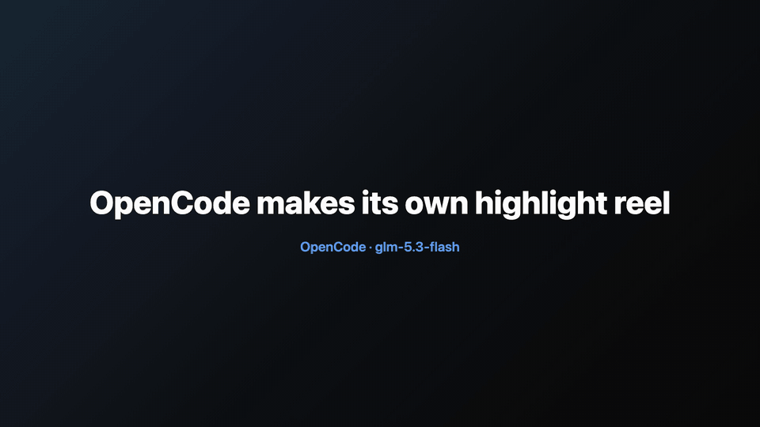

# agent-replay

[](https://skills.sh/vkpdeveloper/agent-replay)

Turn your Claude Code, Codex or OpenCode sessions into videos that look like the
real terminal. Ask for a highlight and your agent cuts it down to the good parts,
with captions.

[](docs/demo.mp4)

## Install

```sh
npx skills add vkpdeveloper/agent-replay
```

Then ask your agent:

- "make a replay of this session"
- "make a vertical highlight of this session so I can post it"
- "make a square video of turns 2 to 4 at 2x speed"

The skill downloads the right binary for your machine on first use and keeps it
updated. Works on macOS, Linux and Windows.

## What you get

- **MP4** in landscape (1920x1080), vertical (1080x1920) or square (1080x1080)
- **Highlights**: your agent picks the moments and writes the captions
- **replay.html**: one file that plays like a video, if you ask for HTML
- **Secrets masked**: API keys, tokens and passwords show up as `********`

## CLI

```sh
curl -fsSL https://raw.githubusercontent.com/vkpdeveloper/agent-replay/main/skill/agent-replay/replay.sh | sh -s -- --version

agent-replay list                                  # your sessions, newest first
agent-replay latest -o demo.mp4                    # MP4 of the newest session
agent-replay latest -o reel.mp4 --format vertical  # or --format square
agent-replay latest -o demo.mp4 --turns 2-3 --speed 2
agent-replay outline latest                        # numbered steps, to pick highlights
agent-replay latest -o clip.mp4 --title 'Fixing the build' \
  --cut '4-9: Finds the bug' --cut '15: Tests pass'
```

Run `agent-replay --help` for everything else.

## License

MIT. Rendering uses [Remotion](https://www.remotion.dev/license), which is free
for individuals and small teams. Larger companies need a Remotion company license.
